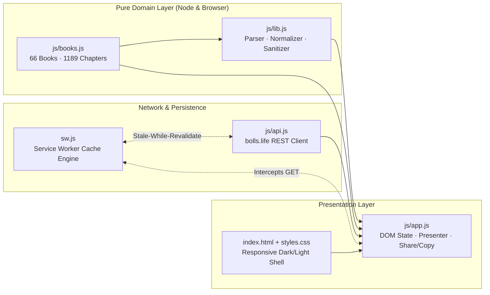

<div align="center">

# ⚡ BIBLIA RV1960 // PWA CORE

**Zero-Dependency Offline-First Progressive Web Application for Biblical Text Exploration & Fullscreen Presentation**


-7b2cbf?style=for-the-badge&labelColor=0b0f19)


-f2c14e?style=for-the-badge&labelColor=0b0f19)

</div>

---

## 🌌 Overview

**Biblia RV1960 PWA** is a high-performance, zero-framework Progressive Web Application engineered with native browser standards (**ES Modules**, **Service Worker Cache Storage**, **Fullscreen API**, **Screen Wake Lock API**, **Clipboard API**, and **Web Share API**). It queries the Reina-Valera 1960 corpus via `bolls.life`, sanitizes embedded HTML/Strong's tags in real time, and persists read chapters locally for seamless operation in low-connectivity environments.

### 🚀 Quick Start

```bash
# 1. Run the automated unit test suite (Node.js 18+)
node tests/lib.test.mjs

# 2. Launch a local static HTTP server (Service Worker requires localhost or HTTPS)
python3 -m http.server 8080

# 3. Open in Chrome / Edge
# -> http://localhost:8080
```

---

## 🧬 Modular Architecture

The system strictly separates pure domain logic from network I/O and DOM manipulation, enabling deterministic headless testing in Node.js without browser mocks.



| Module | Layer | Responsibility | Dependencies |
|--------|-------|----------------|--------------|
| [`js/books.js`](file:///home/raphinha/Proyectos/Universidad/ISC%207/Desarrollo%20de%20software/biblia_pwa/js/books.js) | **Domain Data** | Canonical metadata for all 66 books (`id` 1–66, chapter counts totaling 1,189, collision-free aliases). | *None* |
| [`js/lib.js`](file:///home/raphinha/Proyectos/Universidad/ISC%207/Desarrollo%20de%20software/biblia_pwa/js/lib.js) | **Pure Logic** | `normalize`, `findBook` (exact, alias, unique prefix), `parseReference` (regex parser + inverted range correction), `cleanText` (HTML/Strong tag stripper), `formatRef`. | `js/books.js` |
| [`js/api.js`](file:///home/raphinha/Proyectos/Universidad/ISC%207/Desarrollo%20de%20software/biblia_pwa/js/api.js) | **Data Access** | Asynchronous REST client for `https://bolls.life` (`getChapter`, `getVerse`, and `getRandomVerse`). | Fetch API |
| [`js/app.js`](file:///home/raphinha/Proyectos/Universidad/ISC%207/Desarrollo%20de%20software/biblia_pwa/js/app.js) | **UI Controller** | Event binding, XSS-safe DOM rendering (`escapeHTML`), cross-book chapter navigation, fullscreen presenter with Wake Lock, `localStorage` history, random verse loader, clipboard copy, and native share. | `books.js`, `lib.js`, `api.js`, DOM |
| [`sw.js`](file:///home/raphinha/Proyectos/Universidad/ISC%207/Desarrollo%20de%20software/biblia_pwa/sw.js) | **Offline Worker** | Intercepts network traffic and orchestrates dual-bucket caching (`biblia-shell-v1` & `biblia-api-v1`). | Cache Storage API |

---

## 🛡️ Security & Sanitization Pipeline

External API payloads from `bolls.life` contain raw HTML tags (`<br>`, `<i>`) and Strong's concordance markers (`<S>H430</S>`). To prevent Cross-Site Scripting (XSS) and visual corruption, every verse passes through a two-stage defense-in-depth pipeline before rendering:

1. **Structural Sanitization (`cleanText` in `js/lib.js`):** Strips `<S>...</S>` blocks with their inner indices, converts `<br>` tags into spaces, removes all remaining HTML tags, decodes common entities (`&nbsp;`, `&amp;`, `&lt;`, `&gt;`), and normalizes whitespace.
2. **Output Encoding (`escapeHTML` in `js/app.js`):** Escapes `&`, `<`, `>`, `"`, and `'` prior to DOM insertion.

---

## ⚡ Service Worker Caching Strategy

The Service Worker ([`sw.js`](file:///home/raphinha/Proyectos/Universidad/ISC%207/Desarrollo%20de%20software/biblia_pwa/sw.js)) partitions storage into two versioned caches and applies distinct routing policies per request origin:

| Cache Bucket | Target Scope | Strategy | Runtime Behavior |
|--------------|--------------|----------|------------------|
| `biblia-shell-v1` | Same-origin static assets (`index.html`, `styles.css`, `js/*`, `icons/*`, `manifest.webmanifest`) | **Cache-First** (with Network Fallback) | Pre-cached during `install`. Serves the application shell instantaneously with zero network latency. |
| `biblia-api-v1` | Cross-origin REST calls to `https://bolls.life/get-text/*` and `/get-verse/*` | **Stale-While-Revalidate** | Returns cached chapter JSON immediately if available while refreshing the cache in the background; falls back to network on cache miss. |
| *Bypass (Live)* | `https://bolls.life/get-random-verse/*` | **Network-First** | Ensures every trigger of the `🎲 Al azar` challenge fetches a fresh random verse when online. |

---

## 🌟 Integrated Challenges (★ & ★★)

| Tier | Feature | Implementation Details |
|------|---------|------------------------|
| **★★** | **Random Verse Discovery (`🎲 Al azar`)** | Queries `/get-random-verse/RV1960/` via `getRandomVerse()`, resolves the canonical book from `BOOKS`, loads the full chapter for contextual reading, and highlights/scrolls to the selected verse. |
| **★** | **Smart Clipboard Copy (`📋 Copiar`)** | Formats the active verse selection (or full chapter) with its canonical reference via `navigator.clipboard.writeText()` and provides temporary visual confirmation (`✓ Copiado`). |
| **★** | **Native Web Share (`🔗 Compartir`)** | Automatically detects `navigator.share` support, reveals `#btnShare`, and invokes the OS share sheet with the formatted reference and verse text. |

---

## 🧪 Verification & Testing

Run the zero-dependency test runner powered by Node.js ES Modules:

```bash
node tests/lib.test.mjs
```

- **23 Base Assertions:** Validates accent-insensitive normalization, exact/alias/prefix book matching, regex reference parsing, inverted verse ranges (`7-4` -> `7`), out-of-bounds chapter errors, `cleanText` sanitization, `formatRef` formatting, 66 consecutive book IDs, 1,189 total chapters, and zero alias collisions.
- **2 Rubric Extension Assertions:**
  - `"2 Pedro 1:3"` $\rightarrow$ `{ b: 61, c: 1, vs: 3, ve: 3 }`
  - `"   Rom   8:28 "` (extra whitespace tolerance) $\rightarrow$ `{ b: 45, c: 8, vs: 28, ve: 28 }`

---

## 🌐 Deployment Guide (HTTPS)

Because Service Workers, Fullscreen, Wake Lock, and Web Share APIs require a **Secure Context**, deploy the static root directory to any HTTPS-enabled host:

| Provider | Deployment Workflow | Notes |
|----------|---------------------|-------|
| **GitHub Pages** | Push repository $\rightarrow$ **Settings > Pages** $\rightarrow$ Deploy from `main` branch (`/` root). | Relative paths (`./index.html`, `scope: "./"`) work out-of-the-box under `/<repo-name>/` subpaths. |
| **Cloudflare Pages / Netlify** | Drag-and-drop the `biblia_pwa` folder or connect the Git repository with no build command (`""`) and publish directory `.`. | Instant global CDN with automatic SSL/TLS certificate provisioning. |

> [!IMPORTANT]
> Whenever modifying any file in the application shell, increment `const VERSION = "v1"` in `sw.js` (e.g., to `"v2"`) before deploying so connected clients automatically purge stale caches during the `activate` lifecycle event.
